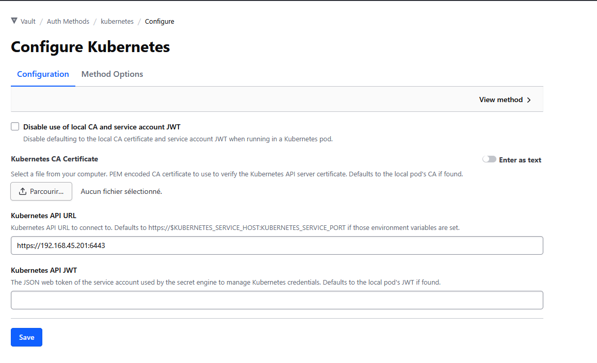

# Prérequis manuels : authentification Vault ↔ Kubernetes


## 1. Créer le Service Account vault-auth

```bash
kubectl apply -f kubernetes/vault/vault-auth-sa.yaml
kubectl apply -f kubernetes/vault/vault-auth-crb.yaml
```

Ce SA reçoit le droit de faire des `tokenreviews` et `subjectaccessreviews`  
— c'est le mécanisme que Vault utilise pour vérifier les tokens des pods.

---

## 2. Récupérer le JWT du SA vault-auth

```bash
kubectl get secret vault-auth-token -n kube-system \
  -o jsonpath='{.data.token}' | base64 -d
```

> Garder ce JWT : c'est la valeur `service_account_jwt` à fournir à Terraform.

---

## 3. Récupérer le CA certificate du cluster

```bash
kubectl config view --raw \
  --minify --flatten \
  -o jsonpath='{.clusters[].cluster.certificate-authority-data}' \
  | base64 -d
```

> Garder ce PEM : c'est la valeur `ca_cert` à fournir à Terraform.

---

Puis créer l'auth medtod kub dans le vault fais via UI



Tout cela just epour l'auth method


------


vault write auth/devver_k8s_prod/config \
  kubernetes_host="https://192.168.45.201:6443" \
  kubernetes_ca_cert=
-----END CERTIFICATE-----" \
  token_reviewer_jwt="" \
  disable_iss_validation=true

------

## Rôles et politiques Devver (deploy-agent, backend, git-gateway)

KV v2 `devver_K8s`, auth Kubernetes `devver_k8s_prod`, lus par ESO.

```bash
ACCESSOR=$(vault auth list -format=json | jq -r '.["devver_k8s_prod/"].accessor')

# Un seul rôle pour tous les projets : chaque namespace p-<id> ne lit que son propre chemin.
vault policy write deploy-agent-eso - <<POLICY
path "devver_K8s/data/projects/{{identity.entity.aliases.$ACCESSOR.metadata.service_account_namespace}}/agent" { capabilities = ["read"] }
path "devver_K8s/data/projects/{{identity.entity.aliases.$ACCESSOR.metadata.service_account_namespace}}/mongo" { capabilities = ["read"] }
path "devver_K8s/data/shared/git-gateway" { capabilities = ["read"] }
POLICY
vault write auth/devver_k8s_prod/role/deploy-agent-eso \
  bound_service_account_names=deploy-agent-eso \
  bound_service_account_namespaces="p-*" \
  token_policies=deploy-agent-eso token_ttl=10m

vault policy write backend-service - <<'POLICY'
path "devver_K8s/data/backend" { capabilities = ["read"] }
path "devver_K8s/data/projects/*" { capabilities = ["create", "update", "read"] }
path "devver_K8s/metadata/projects/*" { capabilities = ["delete", "list"] }
POLICY
vault write auth/devver_k8s_prod/role/backend-service \
  bound_service_account_names=backend-service \
  bound_service_account_namespaces=devver-backend-service \
  token_policies=backend-service token_ttl=1h

vault policy write git-gateway - <<'POLICY'
path "devver_K8s/data/git-gateway" { capabilities = ["read"] }
POLICY
vault write auth/devver_k8s_prod/role/git-gateway \
  bound_service_account_names=git-gateway \
  bound_service_account_namespaces=devver-git-gateway \
  token_policies=git-gateway token_ttl=10m
```

Secrets à créer une fois :

```bash
vault kv put devver_K8s/backend @backend.json   # clés de backend-service/.env.example
ssh-keygen -t ed25519 -N "" -f upstream && ssh-keygen -t ed25519 -N "" -f host
vault kv put devver_K8s/git-gateway gatewaySecret="$(openssl rand -hex 32)" \
  hostKey="$(base64 < host)" upstreamKey=@upstream
vault kv put devver_K8s/shared/git-gateway publicKey=@upstream.pub
```

`gatewaySecret` = `GIT_GATEWAY_SECRET` du backend.
